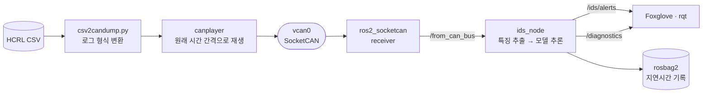

<div align="center">

# 🛡️ ROS2 CAN Intrusion Detection

**학습된 CAN 이상탐지 모델을 실시간 ROS 2 노드로 배포하기**


> 노트북에서 F1이 높았던 모델이 **실제 CAN 버스 속도로 들어오는 메시지**도 제때 판정할 수 있을까?<br/>
> SocketCAN 가상 버스에 공격 로그를 재생하고, ROS 2 노드가 실시간으로 탐지하는 시스템을 만듭니다.

</div>

> [!NOTE]
> 🚧 **계획 단계입니다.** 아직 코드가 없고, 이 README는 프로젝트 설계서입니다.

---

## 📌 문제 정의

[CAN 이상탐지 프로젝트](https://github.com/cbnu-yhjeon/PROJECT-CAN-Anomaly-Detection)는 XGBoost · Isolation Forest · LSTM Autoencoder를 **오프라인 CSV**로 비교했습니다. 실제 차량에 넣으려면 다음 질문에 답해야 합니다.

- 메시지가 들어오는 속도를 따라갈 수 있는가? (DoS 공격은 **0.3 ms마다** 메시지를 주입합니다 → 공격 구간에서 초당 약 3,300개 이상 추가 유입)
- 오프라인에서 만든 특징(`delta_t`, `delta_t_id`)을 **스트리밍 환경에서 똑같이** 계산하는가?
- 공격이 시작된 뒤 **몇 ms 만에** 경보가 나가는가?

## 🎯 목표

| # | 목표 | 성공 기준 |
|:---:|---|---|
| G1 | CSV 로그를 SocketCAN `vcan0`으로 실제 시간 간격대로 재생 | `candump`로 원본과 동일한 순서·간격 확인 |
| G2 | 학습된 모델을 탑재한 ROS 2 탐지 노드 | `/ids/alerts` 토픽 발행 |
| G3 | 오프라인 · 온라인 판정 결과 일치 | 같은 로그에서 F1 차이 1%p 이내 |
| G4 | 지연시간 · 처리량 · 탐지 지연 측정 | 모델별 p50 / p99 표 |
| G5 | Docker Compose로 한 줄 재현 | `docker compose up`으로 전체 시연 |

---

## 🔗 기반 수업과 저장소

| 수업 / 프로젝트 | 가져올 것 | 저장소 |
|---|---|---|
| 차량 CAN 이상탐지 | 전처리 코드, 학습된 모델(`xgb_model.pkl`, `isolation_forest.pkl`, `lstm_autoencoder.pth`)과 스케일러 | [PROJECT-CAN-Anomaly-Detection](https://github.com/cbnu-yhjeon/PROJECT-CAN-Anomaly-Detection) |
| 패턴인식 · 딥러닝 실체 | 분류 · 오토인코더 모델 이해 | [Pattern_Rcognition](https://github.com/cbnu-yhjeon/Pattern_Rcognition) · [Deep-Learning-Entities](https://github.com/cbnu-yhjeon/Deep-Learning-Entities) |
| 기술 스택 | ROS 2, Autoware, Docker | [프로필](https://github.com/cbnu-yhjeon) |

---

## 🧭 시스템 구조



### 탐지 노드 설계 포인트
- **상태를 가진 특징 추출기:** `delta_t_id`(같은 ID의 직전 메시지와의 간격)는 ID별 마지막 수신 시각을 들고 있어야 합니다. 오프라인 전처리 코드를 그대로 옮기고, 같은 입력에서 같은 출력이 나오는지 단위 테스트로 확인합니다.
- **모델별 추론 방식:**

  | 모델 | 단위 | 형식 |
  |---|---|---|
  | XGBoost | 메시지 1개 | 네이티브 JSON 모델 |
  | Isolation Forest | 메시지 1개 | scikit-learn |
  | LSTM Autoencoder | 슬라이딩 윈도우 | TorchScript 또는 ONNX |

- **처리량 확보:** 메시지마다 추론하는 방식과 짧은 마이크로 배치(예: 1 ms) 방식을 비교합니다.

---

## 🗂️ 데이터

| 데이터 | 내용 | 비고 |
|---|---|---|
| [HCRL Car-Hacking Dataset](https://sites.google.com/hksecurity.net/hcrl/Datasets/car-hacking-dataset) | 정상 주행 + DoS · Fuzzy · Gear · RPM 공격 | OBD-II로 수집, 메시지마다 T(주입) / R(정상) 플래그 |

> 데이터 사용 시 HCRL 페이지의 인용 요구사항을 따릅니다. 원본 데이터는 저장소에 넣지 않습니다.

---

## 🧪 실험 설계

| ID | 모델 | 추론 방식 | 측정 |
|:---:|---|---|---|
| R1 | XGBoost | 메시지 단위 | 지연시간, 처리량, F1 |
| R2 | Isolation Forest | 메시지 단위 | 〃 |
| R3 | LSTM-AE | 윈도우 단위 | 〃 + 윈도우 크기별 탐지 지연 |
| R4 | R1 + 마이크로 배치 | 1 ms 배치 | 처리량 개선 폭 |
| R5 | 앙상블 (XGBoost 1차 + LSTM-AE 2차 확인) | 계층형 | 오탐 감소 효과 |

### 지표

| 지표 | 정의 |
|---|---|
| 종단 지연시간 | `vcan0` 수신 시각 → 경보 발행 시각 (p50 / p99) |
| 최대 처리량 | 메시지 유실 없이 처리한 초당 메시지 수 |
| 탐지 지연 | 첫 주입 메시지 시각 → 첫 경보 시각 |
| 온라인 F1 | 스트리밍 판정 기준 F1, 오프라인 결과와 비교 |
| 자원 사용 | CPU · 메모리 (Docker 컨테이너 기준) |

---

## 🗓️ 마일스톤

| 주차 | 내용 | 산출물 |
|:---:|---|---|
| 1 | `vcan` 구성, CSV → candump 변환, 재생 검증 | `scripts/replay.sh` |
| 2 | `ros2_socketcan` 연동, 특징 추출기 이식 + 단위 테스트 | 오프라인 · 온라인 특징 일치 |
| 3 | XGBoost · Isolation Forest 노드 | R1 · R2 |
| 4 | LSTM-AE 내보내기(TorchScript/ONNX), 윈도우 추론 | R3 |
| 5 | 마이크로 배치, 앙상블 | R4 · R5 |
| 6 | Docker Compose, Foxglove 대시보드, 정리 | 시연 영상, 최종 보고서 |

## 📁 디렉토리 구조 (계획)

```
ROS2-CAN-Intrusion-Detection/
├── docker/
│   ├── Dockerfile
│   └── compose.yaml
├── scripts/
│   ├── setup_vcan.sh
│   ├── csv2candump.py
│   └── replay.sh
├── ros2_ws/src/
│   └── can_ids/
│       ├── can_ids/      ids_node.py · features.py · models/
│       ├── launch/       ids.launch.py
│       └── test/         특징 일치 단위 테스트
├── models/               학습된 모델 (원 저장소에서 복사)
├── results/
└── README.md
```

## ⚠️ 리스크와 대응

| 리스크 | 대응 |
|---|---|
| Python 노드가 DoS 구간 처리량을 못 따라감 | 마이크로 배치, 필요하면 특징 추출만 C++ 노드로 분리 |
| `canplayer` 재생 간격이 원본과 미세하게 다름 | 재생 로그를 다시 캡처해 간격 분포를 원본과 비교 |
| 오프라인 학습 특징과 온라인 특징의 불일치 | 같은 로그를 두 경로로 처리해 특징을 행 단위로 비교하는 테스트 |

## 📚 참고 자료

- H. M. Song, J. Woo, H. K. Kim, *In-vehicle network intrusion detection using deep convolutional neural network*, Vehicular Communications 2020 (Car-Hacking Dataset)
- [ros2_socketcan](https://github.com/autowarefoundation/ros2_socketcan)
- [Linux SocketCAN · can-utils](https://github.com/linux-can/can-utils)
- [Foxglove](https://foxglove.dev/)
