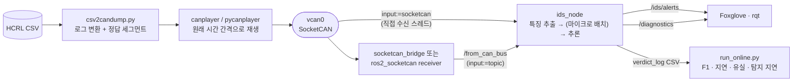

<div align="center">

# 🛡️ ROS2 CAN Intrusion Detection

**학습된 CAN 이상탐지 모델을 실시간 ROS 2 노드로 배포하기**


> 노트북에서 F1이 높았던 모델이 **실제 CAN 버스 속도로 들어오는 메시지**도 제때 판정할 수 있을까?<br/>
> SocketCAN 가상 버스(`vcan0`)에 공격 로그를 원래 간격대로 재생하고, ROS 2 노드가 실시간으로 탐지합니다.

</div>

---

## 📌 문제 정의

[CAN 이상탐지 프로젝트](https://github.com/cbnu-yhjeon/PROJECT-CAN-Anomaly-Detection)는 XGBoost · Isolation Forest · LSTM Autoencoder를 **오프라인 CSV**로 비교했습니다. 실제 차량에 넣으려면 다음 질문에 답해야 합니다.

- 메시지가 들어오는 속도를 따라갈 수 있는가? (DoS 공격은 **0.3 ms마다** 메시지를 주입)
- 오프라인에서 만든 특징(`delta_t`, `delta_t_id`)을 **스트리밍 환경에서 똑같이** 계산하는가?
- 공격이 시작된 뒤 **몇 ms 만에** 경보가 나가는가?

## 🎯 목표와 달성 여부

| # | 목표 | 성공 기준 | 결과 |
|:---:|---|---|---|
| G1 | CSV 로그를 SocketCAN `vcan0`으로 실제 시간 간격대로 재생 | 원본과 같은 순서·간격 | ✅ 순서 보존 (판정 로그를 원본에 정렬해 확인), 송신 시각 오차 p50 ≤ 0.016 ms · p99 0.1~8.5 ms |
| G2 | 학습된 모델을 탑재한 ROS 2 탐지 노드 | `/ids/alerts` 토픽 발행 | ✅ `ids_node` — 4개 모델, 메시지 단위·마이크로 배치, `/ids/alerts` + `/diagnostics` |
| G3 | 오프라인 · 온라인 판정 결과 일치 | 같은 로그에서 F1 차이 1%p 이내 | ✅ 버스를 따라가는 구성은 모두 0.08%p 이내 — 예외: Isolation Forest 1 ms 배치 Gear/RPM 1.2~2.3%p, 메시지 단위 IF는 프레임 유실로 실패 |
| G4 | 지연시간 · 처리량 · 탐지 지연 측정 | 모델별 p50 / p99 표 | ✅ [`results/REPORT.md`](results/REPORT.md) — 68회 온라인 실행 |
| G5 | Docker Compose로 한 줄 재현 | `docker compose up`으로 전체 시연 | ⚠️ 작성 완료, **미검증** (개발 환경에 Docker·root 없음) |

---

## 🧭 시스템 구조



### 노드와 토픽

| 구성요소 | 역할 |
|---|---|
| `ids_node` | `input:=socketcan`이면 `vcan0`을 직접 읽고 (커널 수신 타임스탬프), `input:=topic`이면 `/from_can_bus`(`can_msgs/Frame`)를 구독. 공격 판정은 `/ids/alerts`(`can_ids_msgs/Alert`), 1초마다 처리율·지연 p50/p99·경보 수를 `/diagnostics`로 발행 |
| `socketcan_bridge` | `ros2_socketcan`이 없는 환경용 파이썬 브리지. 같은 토픽·같은 메시지, `header.stamp` = 커널 수신 시각 (`SO_TIMESTAMPNS`) |
| `ros2_socketcan` | Docker 이미지에서 `bridge:=ros2_socketcan`으로 사용 |

### 설계 포인트

- **같은 코드, 두 경로.** 특징 추출 → 배치 → 추론은 ROS와 무관한 [`DetectionEngine`](ros2_ws/src/can_ids/can_ids/engine.py)에 있고, ROS 노드와 오프라인 스트리밍 시뮬레이션이 같은 엔진을 씁니다. 온라인/오프라인 차이는 전송 경로에서만 생깁니다.
- **상태를 가진 특징 추출기.** [`StreamingFeatureExtractor`](ros2_ws/src/can_ids/can_ids/features.py)가 직전 수신 시각과 ID별 마지막 수신 시각을 들고 있습니다. 오프라인 pandas 구현(원 저장소 `add_time_features` + 학습 스크립트의 99 분위수 클리핑)과 **실제 로그 3만 행에서 비트 단위로 같음**을 테스트로 확인합니다.
- **모델별 추론 방식.**

  | 모델 | 단위 | 배포 형식 | 임계값 |
  |---|---|---|---|
  | XGBoost | 메시지 1개 | 네이티브 JSON (`xgb_model.json`) | 확률 > 0.5 |
  | Isolation Forest | 메시지 1개 | ONNX (skl2onnx) | `decision_function` < 0 |
  | LSTM Autoencoder | 직전 50개 메시지 윈도우 | ONNX (기본) / TorchScript | 재구성 MSE > 115.29 (학습 로그의 mean+3σ) |
  | 앙상블 | XGB 양성일 때만 LSTM 확인 | – | 둘 다 양성 |

- **마이크로 배치.** `batch_window_ms` > 0이면 가장 오래된 대기 메시지가 그 시간을 넘기거나 `max_batch`가 차면 한 번에 추론합니다. 특징은 수신 순서대로 즉시 계산하므로 배치 크기가 판정을 바꾸지 않습니다 (테스트).
- **안전한 모델 변환.** 원 저장소 `.pkl`은 numpy/sklearn/xgboost 클래스만 허용하는 제한 언피클러로, `.pth`는 `weights_only=True`로 읽어 JSON/ONNX/TorchScript로 바꿉니다. 변환 전후 판정이 실제 로그 2만 행에서 일치합니다 (XGB·IF 불일치 0, LSTM 오차 상대 1e-5).

---

## 🚀 실행

### 1) 준비 (로컬, ROS 2 Humble)

```bash
python3 -m venv --system-site-packages .venv && . .venv/bin/activate
pip install "numpy<2" pandas scikit-learn==1.7.2 xgboost onnxruntime pytest
pip install torch --index-url https://download.pytorch.org/whl/cpu   # TorchScript 백엔드 · 모델 변환 시만
scripts/download_data.sh data                                          # HCRL 데이터 (~430 MB 압축)
for p in "dos DoS_dataset" "fuzzy Fuzzy_dataset" "rpm RPM_dataset" "gear gear_dataset" "normal normal_run_data"; do
  set -- $p; python scripts/csv2candump.py data/Data/raw/$2.csv -o data/segments/$1 --duration 60
done
source /opt/ros/humble/setup.bash
(cd ros2_ws && colcon build --symlink-install) && source ros2_ws/install/setup.bash
```

> `ros-humble-can-msgs`가 설치돼 있으면 `colcon build --packages-skip can_msgs`로 동봉본(`third_party/can_msgs`)을 건너뜁니다.

### 2) vcan0 + 탐지 노드 + 재생

```bash
# root가 있으면
scripts/setup_vcan.sh vcan0
# root가 없으면: 사용자+네트워크 네임스페이스 안에서 vcan0을 만들고 그 안에서 실행
scripts/in_netns.sh bash

ros2 launch can_ids ids.launch.py model:=xgb input:=socketcan batch_window_ms:=1.0 &
scripts/replay.sh data/segments/dos.log vcan0        # canplayer가 없으면 pycanplayer 사용
ros2 topic echo /ids/alerts                          # 다른 터미널
```

launch 인자: `model` (xgb · iforest · lstm · ensemble), `input` (socketcan · topic), `bridge` (python · ros2_socketcan), `batch_window_ms`, `max_batch`, `backend` (onnx · torchscript), `verdict_log`.

### 3) 실험 재현

```bash
python scripts/benchmark_models.py                                          # 추론 비용
scripts/in_netns.sh .venv/bin/python scripts/run_online.py --suite main --input socketcan
scripts/in_netns.sh .venv/bin/python scripts/run_online.py --suite main --input topic --segments dos
scripts/in_netns.sh .venv/bin/python scripts/run_online.py --suite throughput --input socketcan
python scripts/make_report.py                                               # → results/REPORT.md
python -m pytest ros2_ws/src/can_ids/test                                   # 단위 테스트 22개
```

### 4) Docker Compose (한 줄 시연)

```bash
sudo modprobe vcan                                   # 호스트에서 한 번
docker compose -f docker/compose.yaml up --build     # vcan0 + ids_node + foxglove_bridge + 반복 재생
# Foxglove Studio → ws://localhost:8765 → /ids/alerts, /diagnostics
MODEL=lstm BATCH_MS=1 docker compose -f docker/compose.yaml up
docker compose -f docker/compose.yaml --profile experiments run experiments   # 전체 실험
```

> ⚠️ Docker 구성은 작성만 했고 이 개발 환경(Docker 없음, root 없음)에서는 실행해 보지 못했습니다. 로컬 경로(`in_netns.sh`)로 같은 파이프라인을 끝까지 검증했습니다.

---

## 📊 결과

전체 표: [`results/REPORT.md`](results/REPORT.md) (원자료 `results/*.json`). 각 로그 앞 60초, WSL2 12코어, 1배속은 원본 간격.

**권장 배포 구성: XGBoost + 1 ms 마이크로 배치 + 직접 SocketCAN 입력 (R4)**

| ID | 구성 | F1 온라인 (DoS·Fuzzy·RPM·Gear) | 정상 로그 오탐률 | 종단 지연 p50 / p99 (최악 로그) | 탐지 지연 p50 | 유실 없이 처리한 최대 평균 입력률 |
|---|---|---|---|---|---|---|
| R1 | XGBoost · 메시지 단위 | 1.000 · 0.999 · 1.000 · 1.000 | 0 % | 0.65 / 723 ms | 1.6 ms | 1,253 msg/s |
| **R4** | **XGBoost · 1 ms 배치** | **1.000 · 1.000 · 1.000 · 1.000** | **0 %** | **2.2 / 14 ms** | **1.9 ms** | **≥ 20,052 msg/s (16배속)** |
| R2 | Isolation Forest · 메시지 단위 | 버스를 못 따라감 (DoS 58 % 유실, 지연 22 s) | – | 22 s / 49 s | – | < 1,253 msg/s |
| R2b | Isolation Forest · 1 ms 배치 | 0.000 · 0.830 · 0.068 · 0.022 | 2.9 % | 9.9 / 219 ms | 75 ms | ≥ 20,052 msg/s |
| R3b | LSTM-AE · 1 ms 배치 | 0.000 · 0.507 · 0.000 · 0.000 | 0 % | 1.7 / 11 ms | 10.5 ms | 2,506 msg/s |
| R5 | 앙상블 (XGB → LSTM 확인) | 0.000 · 0.866 · 0.000 · 0.000 | 0 % | 2.1 / 19 ms | 13.7 ms | 5,013 msg/s |

### 알게 된 것

1. **병목은 모델이 아니라 메시지당 고정 비용이다.** XGBoost 추론은 배치 1에서 ~0.1 ms이지만 배치 128에서는 메시지당 2 µs다. 메시지 단위 R1은 2,000 msg/s급 RPM·Gear 로그에서 큐가 쌓여 p99가 0.4~0.7초까지 튀었고, 1 ms 배치(R4)는 같은 로그에서 p99 14 ms, DoS 16배속(평균 2만 msg/s)에서도 p99 4.2 ms였다. 평균 지연은 1~2 ms 늘어나는 대신 꼬리 지연이 50배 줄었다.
2. **Isolation Forest는 메시지 단위로는 배포할 수 없다.** 200개 트리 ONNX 추론이 메시지당 1~2 ms라 1,250 msg/s를 못 따라가고, 모든 로그에서 프레임의 46~83 %를 잃었다(온라인 F1이 오프라인보다 높게 나온 RPM·Gear 값은 살아남은 일부 프레임만 판정한 착시). 배치로 바꾸면 따라가지만 탐지 성능 자체가 낮다 (Fuzzy만 F1 0.83).
3. **ROS 토픽 경로(파이썬 브리지 → DDS → rclpy 콜백)가 추론보다 비싸다.** 같은 XGBoost 메시지 단위에서 직접 SocketCAN은 p50 0.28 ms, 토픽 경로는 p50 185 ms · p99 2.2 s (CPU 79 %). 토픽 경로도 1 ms 배치면 p99 7.8 ms로 회복된다. 그래서 `ids_node`에 직접 수신 모드(`input:=socketcan`)를 넣었다 — README 계획의 "필요하면 C++ 노드로 분리" 대신 DDS 홉을 없앴다.
4. **오프라인 결과는 그대로 재현된다.** 버스를 따라가는 구성에서 온라인/오프라인 F1 차이는 최대 0.08 %p, 판정 일치율은 99.95 % 이상이다. 온라인 특징은 원본 타임스탬프가 아니라 커널 수신 시각으로 계산되는데도 차이가 작았다. 단, 시간 특징에 민감한 Isolation Forest는 Gear·RPM에서 1.2~2.3 %p 벌어졌다.
5. **앙상블은 오탐을 줄이지 못하고 재현율만 깎는다.** XGBoost가 이미 정상 로그 오탐 0 %이고, LSTM-AE는 DoS·RPM·Gear를 전혀 못 잡아서 (36개 공격 구간 중 29개 놓침) "XGB 양성 AND LSTM 확인" 규칙은 그 구간들을 모두 지운다. 이 모델 조합에서는 XGBoost 단독(R4)이 낫다.

---

## 🗂️ 데이터

| 데이터 | 내용 | 비고 |
|---|---|---|
| [HCRL Car-Hacking Dataset](https://sites.google.com/hksecurity.net/hcrl/Datasets/car-hacking-dataset) | 정상 주행 + DoS · Fuzzy · Gear · RPM 공격 | 메시지마다 T(주입) / R(정상) 플래그 |

> 데이터 사용 시 HCRL 페이지의 인용 요구사항을 따릅니다. 원본 데이터는 저장소에 넣지 않습니다 (`data/`는 `.gitignore`).

구현하면서 확인한 데이터 특성:

- **네 공격 파일 끝에 같은 정상 로그 89만 행이 붙어 있습니다** (마지막 타임스탬프가 모두 `1478201209.058944`). 원 저장소는 다섯 파일을 합친 뒤 시간순 정렬해서 이 꼬리가 4번 겹쳐 들어갔습니다. 이 프로젝트는 파일별 앞 60초만 쓰므로 영향이 없습니다.
- DLC < 8 행은 필드 수가 적어 원 저장소 로더에서 flag가 NaN이 됩니다. 공격(T) 행 중 DLC < 8은 없어서 라벨 결과는 같지만, 로더는 flag를 `3 + DLC` 위치에서 정확히 읽습니다.
- 학습 때 쓴 클리핑 상한(`delta_t` 5.598e-3 s, `delta_t_id` 8.639 s)과 LSTM 임계값(115.286)은 모델 파일에 저장돼 있지 않아 학습 로그에서 가져왔습니다 ([`model_meta.json`](models/model_meta.json)).

---

## 📁 디렉토리 구조

```
ROS2-CAN-Intrusion-Detection/
├── docker/                 Dockerfile · compose.yaml · entrypoint.sh
├── scripts/
│   ├── setup_vcan.sh       vcan0 생성 (root)
│   ├── in_netns.sh         root 없이 사용자 네임스페이스 안에 vcan0
│   ├── csv2candump.py      HCRL CSV → candump 로그 + 정답 세그먼트
│   ├── replay.sh · pycanplayer.py   원래 간격 재생 (canplayer / 파이썬 대체)
│   ├── export_models.py    원 저장소 모델 → JSON / ONNX / TorchScript (+검증)
│   ├── benchmark_models.py 추론 비용
│   ├── run_online.py       온라인 실험 실행기
│   └── make_report.py      results/REPORT.md 생성
├── ros2_ws/src/
│   ├── can_ids/            ids_node · socketcan_bridge · features · engine · evaluate · models/
│   ├── can_ids_msgs/       Alert.msg
│   └── third_party/can_msgs/  can_msgs/Frame (ros2_socketcan 호환 동봉본)
├── models/                 배포용 모델 + model_meta.json
└── results/                REPORT.md · *.json
```

## ⚠️ 한계

- 측정은 WSL2(12코어) 위 가상 버스입니다. 실제 ECU·임베디드 보드의 수치와 다릅니다.
- 재생기는 파이썬 busy-wait 방식이라 송신 시각 오차가 p99 0.1~8.5 ms 있습니다 (노드와 CPU를 나눠 쓰는 실행일수록 큼). 온라인 특징은 원본이 아니라 **실제 수신 시각**으로 계산되므로 이 오차까지 포함한 결과입니다.
- XGBoost는 원 저장소에서 전체 데이터를 무작위 분할해 학습했으므로 이 60초 구간도 학습에 쓰였을 수 있습니다. F1 수치는 일반화 성능이 아니라 **오프라인 대비 온라인 재현성**을 보는 용도입니다.

## 📚 참고 자료

- H. M. Song, J. Woo, H. K. Kim, *In-vehicle network intrusion detection using deep convolutional neural network*, Vehicular Communications 2020 (Car-Hacking Dataset)
- [ros2_socketcan](https://github.com/autowarefoundation/ros2_socketcan) · [Linux SocketCAN · can-utils](https://github.com/linux-can/can-utils) · [Foxglove](https://foxglove.dev/)
